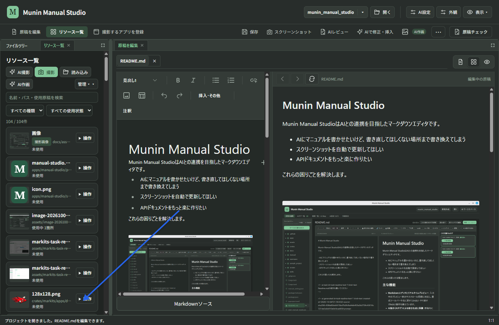
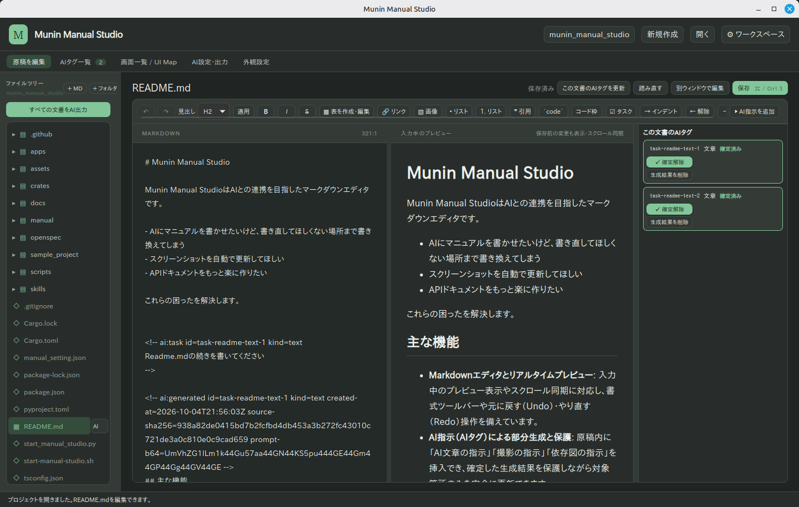

<!-- screenshot:ref id=shot-cf095202-2803-4c3b-975b-a6bbae9984f0 -->



<!-- /screenshot:ref -->

# Munin Manual Studio

Munin Manual StudioはAIとの連携を目指したマークダウンエディタです。

* AIにマニュアルを書かせたいけど、書き直してほしくない場所まで書き換えてしまう
* スクリーンショットを自動で更新してほしい
* APIドキュメントをもっと楽に作りたい

これらの困りごとを解決します。

<br />



* [主な機能](#主な機能)
* [クイックスタート](#クイックスタート)

## 主な機能

* **Markdown編集とプレビュー**: 左右分割プレビュー、Mermaid作図、リッチテキスト・書式ツールバーに対応します。
* **AIによる部分修正**: 選択した文章やMermaidの図を生成・修正し、差分を確認して反映できます。
* **スクリーンショット管理**: AIなしで操作記録・撮影・注釈・クロップを行い、再撮影や候補比較、旧版の復元ができます。
* **リソース管理**: 撮影・取り込み・AI作画の画像を一覧にまとめ、使用原稿の確認や挿入、差し替えができます。
* **原稿チェックとHTML出力**: アプリで原稿を確認し、外部連携またはCLIで静的HTMLマニュアルを出力できます。

## クイックスタート

MarkItsは`crates/markits`のGitサブモジュールとして管理しています。初回取得時は次を実行してください。

```sh
git clone --recurse-submodules https://github.com/tamon-ishii/munin_manual_studio.git
```

既存のチェックアウトでは、`git submodule update --init --recursive`で取得できます。親リポジトリの更新後も同じコマンドで参照先を合わせてください。

起動ランチャーはMarkItsのソースが未取得の場合に自動で取得します。以前の構成のキャッシュやデータが残っている場合は、`.munin/launcher-backups`へ保管してから取得し、ビルドキャッシュを再利用します。

Python 3を用意し、プロジェクトルート（`start_manual_studio.py`のあるフォルダー）で実行します。初回ビルドにはnpmとCargoも必要です。

```sh
python3 start_manual_studio.py
```

1. 対象プロジェクトのフォルダーをワークスペースとして開きます。
2. 左のファイルツリーで原稿を選ぶか、「＋ 作成 → 原稿を作成」で新規作成します。
3. 「AI設定」で接続を設定します。修正する文章・Mermaidコードを選択するか、追加位置にカーソルを置き、「AIで修正・挿入」（選択中は「選択範囲をAIで修正」、Ctrl/Cmd+Shift+G）を開きます。指示を入力して「候補を作成」を押し、差分を確認して「選んだ変更を反映」で確定します。
4. プレビューと「原稿チェック → 原稿をチェック」で内容を確認します。HTML出力は外部連携またはCLIから実行します。準備とコマンドは[HTML出力と困ったときの対処](manual_doc/publishing-and-troubleshooting.md)を参照してください。

デスクトップ版でスクリーンショットを追加するには、次の手順で操作します。撮影・再撮影にAI設定は不要です。

1. 画面上部の「リソース一覧」の右隣にある「撮影するアプリを登録」で起動パス・引数を登録します。
2. 「撮影」でアプリを選び、「記録を開始」を押します。撮影したい画面を表示し、「記録を終了して撮影」を押します。
3. MarkItsで注釈・クロップを編集して保存します。候補として保存された場合は「履歴・管理」で比較・採用します。
4. 「文書に挿入」で原稿と挿入位置を選びます。

文章・図のAI接続は「AI設定」→「文章・図の生成」で設定し、変更は自動保存されます。

* **CLIツール**：対応するAI CLIをPATHから実行できるようにし、認証を済ませて「AIエージェント」を選びます。
* **ローカルLLM**：OllamaやLM Studioなどを起動し、エンドポイントURLとモデルを指定します。
* **クラウドAPI**：OpenAI互換APIのエンドポイントURL、APIキー、モデルを指定します。

詳しくは[原稿編集とAI支援](manual_doc/editing-and-ai.md)、画像の保存・移行は[スクリーンショット管理](docs/specs/screenshot-library.md)を参照してください。

現行の機能・保存先・互換仕様は [仕様一覧](docs/specs/README.md)、要件と変更計画の区別は [OpenSpecの案内](openspec/README.md) を参照してください。
