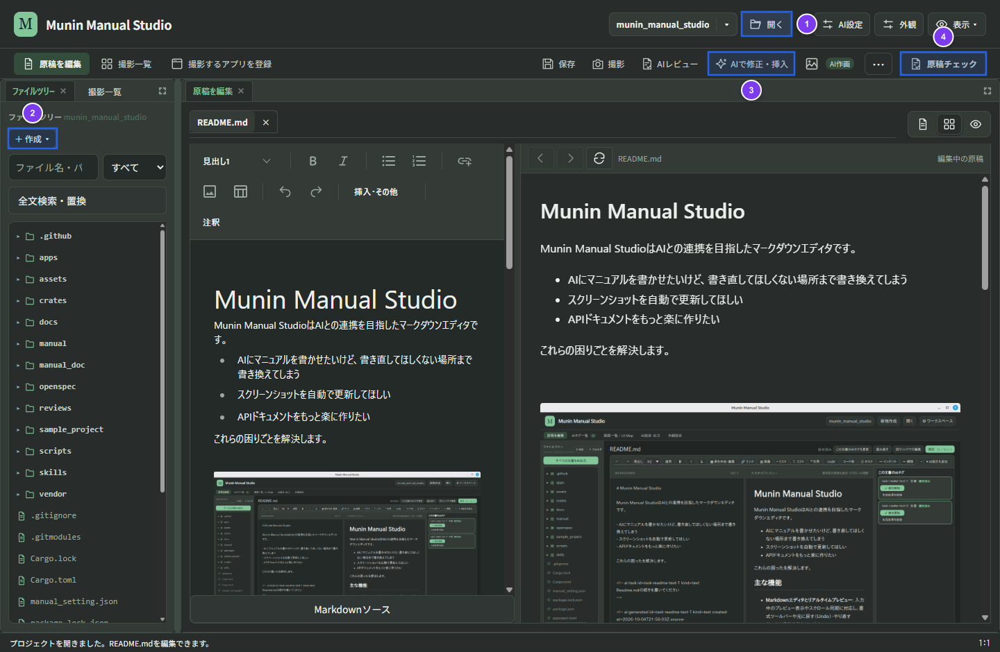
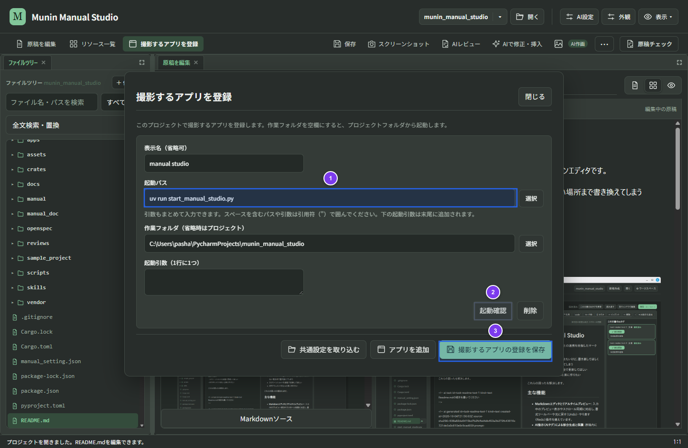
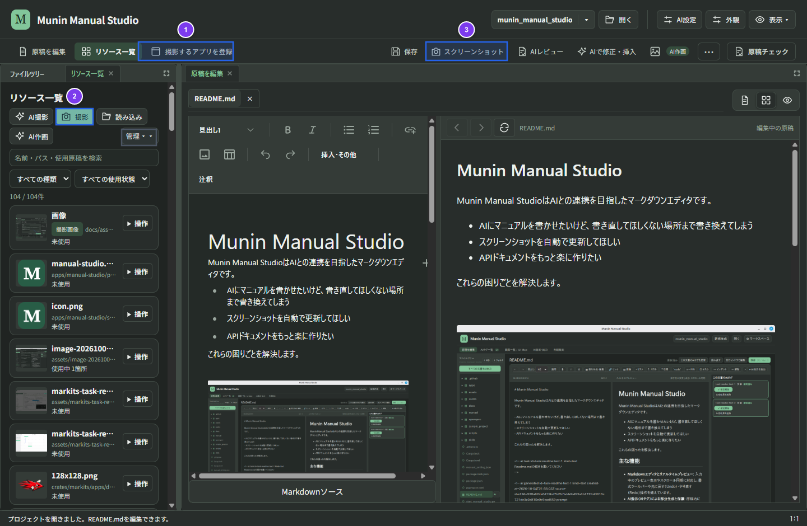

# Munin Manual Studio

Munin Manual StudioはAIとの連携を目指したマークダウンエディタです。

* AIにマニュアルを書かせたいけど、書き直してほしくない場所まで書き換えてしまう
* スクリーンショットを自動で更新してほしい
* APIドキュメントをもっと楽に作りたい

これらの困りごとを解決します。

<br />



* [主な機能](#主な機能)
* [クイックスタート](#クイックスタート)
* [スクリーンショットの撮影と管理](#スクリーンショットの撮影と管理)
* [AI接続とAIターミナル](#ai接続とaiターミナル)
* [関連ドキュメント](#関連ドキュメント)

## 主な機能

* **Markdown編集**: リッチテキスト編集・Markdownソース編集の切替、分割プレビュー（編集＋プレビュー）、Mermaid図、書式ツールバー、全文検索・置換・Git履歴に対応。
* **AI部分修正・レビュー**: 「AIで修正・挿入」で選択範囲やカーソル位置の文章・図を生成し、Diffを確認して反映。「AIレビュー」で本文を変更せずに読者目線・校正・画像整合をチェック。
* **スクリーンショット管理（MarkIts連携）**: AI設定なしで実画面の撮影・操作記録・注釈・クロップ・再撮影・候補比較が可能。
* **リソース管理**: プロジェクト内の撮影画像・通常画像・AI作画を一覧管理し、使用原稿の確認・挿入・差し替えに対応。
* **AIターミナル連携**: Codex・Claude・Agyをアプリ内ターミナルから起動し、同梱MarkItsツール（`--studio-tools`）で実画面の撮影・UIMap解析・注釈付きマニュアル生成を実行。
* **原稿チェック・HTML出力**: リンク切れや画像参照を「原稿チェック」で確認し、外部連携やCLI（MkDocs）で静的HTMLを出力。

## クイックスタート

### 前提条件

* **配布版を利用する場合**: GitHub ReleasesのZIPを展開し、OSごとの実行ファイル（Windows: `manual-studio.exe`、macOS: `Munin Manual Studio.app`、Linux: `manual-studio`）を起動します。Markdown編集と手動撮影にNode.jsやRustは不要です。
* **ソースから起動する場合**: Python 3、Node.js（npm）、Rust（Cargo）を用意します。MarkItsは`crates/markits`のGitサブモジュールとして管理しています。

初回取得時は次を実行してください。

```sh
git clone --recurse-submodules https://github.com/tamon-ishii/munin_manual_studio.git
```

既存のチェックアウトでは、`git submodule update --init --recursive`で取得できます。親リポジトリの更新後も同じコマンドで参照先を合わせてください。

起動ランチャーはMarkItsのソースが未取得の場合に自動で取得します。以前の構成のキャッシュやデータが残っている場合は、`.munin/launcher-backups`へ保管してから取得し、ビルドキャッシュを再利用します。

プロジェクトルート（`start_manual_studio.py`のあるフォルダー）で次を実行して起動します。

```sh
python3 start_manual_studio.py
```

### 基本の操作手順


1. 画面上部の「**開く**」（①）を押し、対象プロジェクトのフォルダーをワークスペースとして開きます（フォルダ名メニューから最近開いたフォルダーも選べます）。
2. 左ペインのファイルツリーで既存の原稿を選ぶか、「**＋ 作成 ▾**」（②）から新規原稿を作成して編集します。
3. 必要に応じて「**AI設定**」で接続を設定します。修正する文章やMermaidコードを選択するか挿入位置にカーソルを置き、「**AIで修正・挿入**」（③、選択中は「選択範囲をAIで編集」、Ctrl/Cmd+Shift+G）を開きます。指示を入力して「候補を作成」を押し、差分（Diff）を確認して「選んだ変更を反映」で確定します。
4. 右側のプレビューと上部の「**原稿チェック**」（④）でリンクや画像参照を確認し、「**保存**」（Ctrl/Cmd+S）で原稿を保存します。

**操作後の結果**: 編集したMarkdown原稿がプロジェクトに保存され、プレビューに即座に反映されます。HTML出力の準備とコマンドは[HTML出力と困ったときの対処](manual_doc/publishing-and-troubleshooting.md)を参照してください。

## スクリーンショットの撮影と管理

デスクトップ版でスクリーンショットを追加・更新するには、次の手順で操作します。手動での撮影・再撮影・MarkIts編集にAI設定は不要です。

### 1. 撮影するアプリの登録



1. 上部ナビゲーションの「**撮影するアプリを登録**」を開き、「**起動パス**」（①）に対象アプリの実行ファイルまたは起動コマンド、必要に応じて表示名・作業フォルダ・起動引数を入力します。
2. 「**起動確認**」（②）を押して、対象アプリが意図どおり起動するか確認します。
3. 「**撮影するアプリの登録を保存**」（③）を押してプロジェクトに設定を保存します。

**操作後の結果**: 登録内容がプロジェクトの`.munin/launch_commands.json`に保存され、撮影時に呼び出せるようになります。

### 2. 画面の撮影・注釈と原稿への挿入



1. 必要に応じて「**撮影するアプリを登録**」（①）で対象アプリを準備します。
2. 左ペイン「**リソース一覧**」の「**撮影**」（②）、または原稿上部の「**スクリーンショット**」（③）から撮影を開始します。
3. 対象アプリの画面を表示して撮影し、MarkItsで番号バッジ・枠線・矢印・吹き出し・クロップを編集して保存します。
4. 原稿の「スクリーンショット」から開始した場合は挿入位置を確認して原稿へ反映します。「リソース一覧」から撮影した場合は、対象画像の操作メニューから「文書に挿入」を選びます。アプリ画面が変わった場合は「**管理 ▾**」から再撮影や候補の比較・採用を行えます。

**操作後の結果**: 原本と編集履歴を保持したまま完成画像が`docs/assets/`（またはプロジェクトの画像保存先）に出力され、原稿内にMarkdown画像リンクが挿入されます。

## AI接続とAIターミナル

文章・図のAI接続は画面上部の「**AI設定**」で設定し、変更は自動保存されます。

* **CLIツール**: 対応するAI CLI（Agy / Claude / Codex）をPATHから実行できるようにし、認証を済ませて「AIエージェント」を選びます。
* **ローカルLLM**: OllamaやLM Studioなどを起動し、エンドポイントURLとモデルを指定します。
* **クラウドAPI**: OpenAI互換APIのエンドポイントURL、APIキー、モデルを指定します。

また、アプリ内の「**AIターミナル**」からAI CLIを起動すると、`.munin/ai-terminal/`に生成されるガイド（`guide.md`、`tools.json`、`markits-manual.md`）と同梱の`--studio-tools`を通じて、実画面の撮影・UIMap確認・MarkIts注釈・原稿執筆をAIに依頼できます。AIがファイルを更新した後は、Studioの「⋯ → 変更を読み直す」でファイルツリーと原稿へ反映できます。

## 関連ドキュメント

* 利用者向けガイド:
  *  [Munin Manual Studio 利用ガイド](manual_doc/index.md)
  * [準備と最初の原稿作成](manual_doc/getting-started.md)
  * [原稿編集とAI支援](manual_doc/editing-and-ai.md)
  * [画像とスクリーンショットの管理](manual_doc/images-and-screenshots.md)
  * [HTML出力と困ったときの対処](manual_doc/publishing-and-troubleshooting.md)
  * [全文検索・置換・Git履歴](manual_doc/search-outline-and-git.md)
* アプリ起動・開発環境の説明: [Manual Studio README](apps/manual-studio/README.md)
* 現行の機能・保存先・互換仕様: [仕様一覧](docs/specs/README.md)
* 要件と変更計画の区別: [OpenSpecの案内](openspec/README.md)
