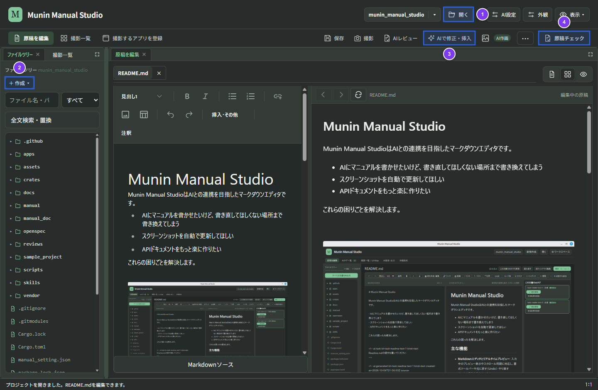
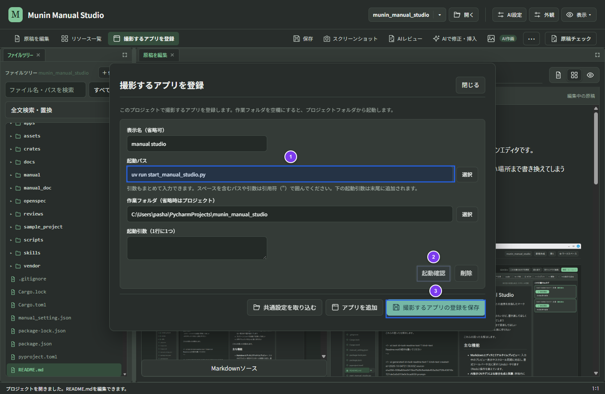
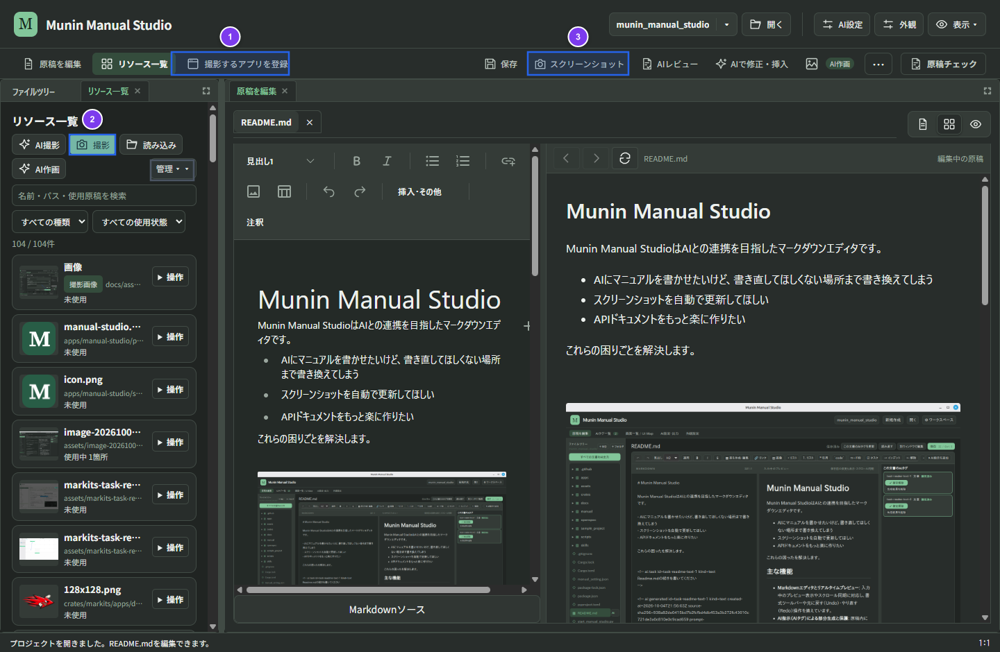

# Munin Manual Studio

**「AIとつくる、壊さない。」マニュアル制作を劇的に効率化する次世代マークダウンエディタ**

マニュアルやドキュメントの作成で、こんな悩みはありませんか？

* **「AIに任せたのに、変えてほしくない場所まで勝手に書き換えられた…」**
* **「画面が変わるたびにスクリーンショットを撮り直すのが面倒…」**
* **「日々のドキュメント作成・更新をもっとラクに終わらせたい！」**

**Munin Manual Studio** なら、必要な箇所だけを安全にAI編集し、スクリーンショットの撮影・注釈・再撮影までこれひとつで完結できます。

<br />

<br />

<br />



* [主な機能](#主な機能)
* [クイックスタート](#クイックスタート)
* [スクリーンショットの撮影と管理](#スクリーンショットの撮影と管理)
* [AI接続とAIターミナル](#ai接続とaiターミナル)
* [関連ドキュメント](#関連ドキュメント)

## 主な機能

* **Markdown編集**: リッチテキスト編集・Markdownソース編集の切替、分割プレビュー（編集＋プレビュー）、Mermaid図、書式ツールバー、全文検索・置換・Git履歴に対応。
* **AI部分修正・レビュー**: 「AIで修正・挿入」で選択範囲やカーソル位置の文章・図を生成し、Diffを確認して反映。「AIレビュー」で本文を変更せずに読者目線・校正・画像整合をチェック。
* **スクリーンショット管理（MarkIts連携）**: AI設定なしで実画面の撮影・操作記録・注釈・クロップ・再撮影・候補比較が可能。
* **リソース管理**: プロジェクト内の撮影画像・通常画像・AI作画を一覧管理し、使用原稿の確認・挿入・差し替えに対応。
* **AIターミナル連携**: Codex・Claude・Agyをアプリ内ターミナルから起動し、同梱MarkItsツール（`--studio-tools`）で実画面の撮影・UIMap解析・注釈付きマニュアル生成を実行。
* **原稿チェック・HTML出力**: リンク切れや画像参照を「原稿チェック」で確認し、MkDocsまたはZensicalで静的HTMLを出力。

## クイックスタート

### 前提条件

* **配布版を利用する場合**: GitHub ReleasesのZIPを展開し、OSごとの実行ファイル（Windows: `manual-studio.exe`、macOS: `Munin Manual Studio.app`、Linux: `manual-studio`）を起動します。Markdown編集と手動撮影にNode.jsやRustは不要です。
* **ソースから起動する場合**: Python 3、Node.js（npm）、Rust（Cargo）を用意します。MarkItsは`crates/markits`のGitサブモジュールとして管理しています。

初回取得時は次を実行してください。

```sh
git clone --recurse-submodules https://github.com/tamon-ishii/munin_manual_studio.git
```

既存のチェックアウトでは、`git submodule update --init --recursive`で取得できます。親リポジトリの更新後も同じコマンドで参照先を合わせてください。

起動ランチャーはMarkItsのソースが未取得の場合に自動で取得します。以前の構成のキャッシュやデータが残っている場合は、`.munin/launcher-backups`へ保管してから取得し、ビルドキャッシュを再利用します。

プロジェクトルート（`start_manual_studio.py`のあるフォルダー）で次を実行して起動します。

```sh
python3 start_manual_studio.py
```

### 基本の操作手順


1. 画面上部の「**開く**」（①）を押し、対象プロジェクトのフォルダーをワークスペースとして開きます（フォルダ名メニューから最近開いたフォルダーも選べます）。
2. 左ペインのファイルツリーで既存の原稿を選ぶか、「**＋ 作成 ▾**」（②）から新規原稿を作成して編集します。
3. 必要に応じて「**AI設定**」で接続を設定します。修正する文章やMermaidコードを選択するか挿入位置にカーソルを置き、「**AIで修正・挿入**」（③、選択中は「選択範囲をAIで編集」、Ctrl/Cmd+Shift+G）を開きます。指示を入力して「候補を作成」を押し、差分（Diff）を確認して「選んだ変更を反映」で確定します。
4. 右側のプレビューと上部の「**原稿チェック**」（④）でリンクや画像参照を確認し、「**保存**」（Ctrl/Cmd+S）で原稿を保存します。

**操作後の結果**: 編集したMarkdown原稿がプロジェクトに保存され、プレビューに即座に反映されます。HTML出力の準備とコマンドは[HTML出力と困ったときの対処](manual_doc/publishing-and-troubleshooting.md)を参照してください。

### HTMLを出力する

上部の「HTML出力」を開き、「MkDocs」または「Zensical」を選んで「HTMLを作成」を押します。「出力先フォルダー」はデスクトップ版の「参照…」で選ぶか、プロジェクトからの相対パスを入力します。「出力先を保存」または「HTMLを作成」で変更が保存され、両ツールの出力先に使われます。

デスクトップ版はHTMLの作成が完了すると、出力したトップページを自動で開きます。「HTMLを開く」から、入力欄の出力先にあるトップページを再度開けます。

「設定」→「HTML出力」で、公開サイト名と既定の出力先を保存できます。サイト名は再出力時に反映されます。

Studioから参照できるPATHに `zensical` があれば、そのまま使えます。プロジェクトの `.venv` にインストールしたZensicalも利用できます。PATHを変更した場合はStudioを起動し直してください。CLIでは `manualctl build-zensical --root PROJECT` を使えます。Studioは公開用の一時設定を生成し、ZensicalにはMaterialに近いclassicテーマを使います。

## スクリーンショットの撮影と管理

デスクトップ版でスクリーンショットを追加・更新するには、次の手順で操作します。手動での撮影・再撮影・MarkIts編集にAI設定は不要です。

### 1. 撮影するアプリの登録



1. 上部ナビゲーションの「**撮影するアプリを登録**」を開き、「**起動パス**」（①）に対象アプリの実行ファイルまたは起動コマンド、必要に応じて表示名・作業フォルダ・起動引数を入力します。
2. 「**起動確認**」（②）を押して、対象アプリが意図どおり起動するか確認します。
3. 「**撮影するアプリの登録を保存**」（③）を押してプロジェクトに設定を保存します。

**操作後の結果**: 登録内容がプロジェクトの`.munin/launch_commands.json`に保存され、撮影時に呼び出せるようになります。

### 2. 画面の撮影・注釈と原稿への挿入



1. 必要に応じて「**撮影するアプリを登録**」（①）で対象アプリを準備します。
2. 左ペイン「**リソース一覧**」の「**撮影**」（②）、または原稿上部の「**スクリーンショット**」（③）から撮影を開始します。
3. 対象アプリの画面を表示して撮影し、MarkItsで番号バッジ・枠線・矢印・吹き出し・クロップを編集して保存します。
4. 原稿の「スクリーンショット」から開始した場合は挿入位置を確認して原稿へ反映します。「リソース一覧」から撮影した場合は、対象画像の操作メニューから「文書に挿入」を選びます。アプリ画面が変わった場合は「**管理 ▾**」から再撮影や候補の比較・採用を行えます。

**操作後の結果**: 原本と編集履歴を保持したまま完成画像が`docs/assets/`（またはプロジェクトの画像保存先）に出力され、原稿内にMarkdown画像リンクが挿入されます。

## AI接続とAIターミナル

文章・図のAI接続は画面上部の「**AI設定**」で設定し、変更は自動保存されます。

* **CLIツール**: 対応するAI CLI（Agy / Claude / Codex）をPATHから実行できるようにし、認証を済ませて「AIエージェント」を選びます。
* **ローカルLLM**: OllamaやLM Studioなどを起動し、エンドポイントURLとモデルを指定します。
* **クラウドAPI**: OpenAI互換APIのエンドポイントURL、APIキー、モデルを指定します。

アプリ内の「**AIターミナル**」でCodexまたはClaude Codeを起動すると、StudioのローカルMCPサーバー `munin-studio` がそのセッションに追加されます。`/mcp` で接続を確認でき、ウィンドウ一覧、スクリーンショット撮影、画像のUIMap確認、MarkIts注釈、操作スクリプトの検証をAIに依頼できます。MCPの保存先はStudioで開いているプロジェクトです。

Codex・Claude Code・Agyでは「自動承認」を切り替えられます。オンにすると、次の接続でCLIが対応する自動審査モードを使います。接続中に切り替えると再接続の確認が表示されます。

`annotate-and-insert` は、既存のスクリーンショットを `scene` で加工して新しいPNGに保存し、開いている原稿のカーソル位置に挿入します。必須引数は `image`、`output`、`scene` です。挿入後の原稿は未保存なので、内容を確認してから保存できます。新しく撮影する場合は、先に `capture` を使います。

| MCPツール | 用途 |
|---|---|
| `active-editor` | 開いている原稿とカーソル位置、未保存の有無を確認します。`include_content: true` で編集中の本文も取得できます。 |
| `find-images` | `query` で、画像や撮影リソースを名前、パス、使用先の原稿から検索します。 |
| `insert-image` | `image` にPNGまたはJPEGのパス、または `resource_id` に撮影リソースIDを指定し、カーソル位置へ挿入します。 |
| `preview-edit` | `page`、`before`（現在の本文）、`after`（変更案）を渡し、Studioで選んだ差分だけを原稿に反映します。 |
| `proofreading-skills` | 標準およびプロジェクト独自の推敲スキルとルールを取得します。 |
| `proofread-text` | `source` と `skill` を渡すと、設定済みのAPIまたはローカルLLMで添削し、Markdownを `content` で返します。 |
| `proofread` | `page`、現在の本文 `before`、スキルIDをキーにした最大3案の `drafts` を渡します。Studioで差分ごとに採用した箇所を、未保存の編集として反映します。 |
| `import-generated-image` | 接続中のAIクライアントが生成した画像を `image` で指定し、Studioの生成画像リソースに取り込みます。応答の `path` を `insert-image` に渡せます。 |

画像生成と原稿の添削は、AIターミナルからMCP経由で扱います。Studioの「原稿チェック」では、ローカルリンクや画像参照の検査と、保存済みのレビュー結果の確認ができます。

プロジェクト独自の推敲スキルは、プロジェクト直下の `.munin/proofreading-skills.json` に追加します。IDは半角英数字、ハイフン、アンダースコアを使い、標準スキルと重複させないでください。

```json
[
  {"id":"house-style","rules":"文末を「です・ます」に統一し、ボタン名を「」で囲む。"}
]
```

`insert-image` と `preview-edit` はエディター上の編集として反映され、原稿の保存はStudioから行います。

`.munin/ai-terminal/` のガイドと同梱の `--studio-tools` は、Agyや操作スクリプトの実行にも利用できます。ファイルの追加・削除・名前変更はファイルツリーに自動で反映されます。開いている原稿が外部で更新されると、Studioは編集中の変更がない場合に自動で読み直します。未保存の変更がある場合は編集内容を保持し、外部更新を通知します。

## 関連ドキュメント

* 利用者向けガイド:
  * [Munin Manual Studio 利用ガイド](manual_doc/index.md)
  * [準備と最初の原稿作成](manual_doc/getting-started.md)
  * [原稿編集とAI支援](manual_doc/editing-and-ai.md)
  * [画像とスクリーンショットの管理](manual_doc/images-and-screenshots.md)
  * [HTML出力と困ったときの対処](manual_doc/publishing-and-troubleshooting.md)
  * [全文検索・置換・Git履歴](manual_doc/search-outline-and-git.md)
* アプリ起動・開発環境の説明: [Manual Studio README](apps/manual-studio/README.md)
* 現行の機能・保存先・互換仕様: [仕様一覧](docs/specs/README.md)
* 要件と変更計画の区別: [OpenSpecの案内](openspec/README.md)
