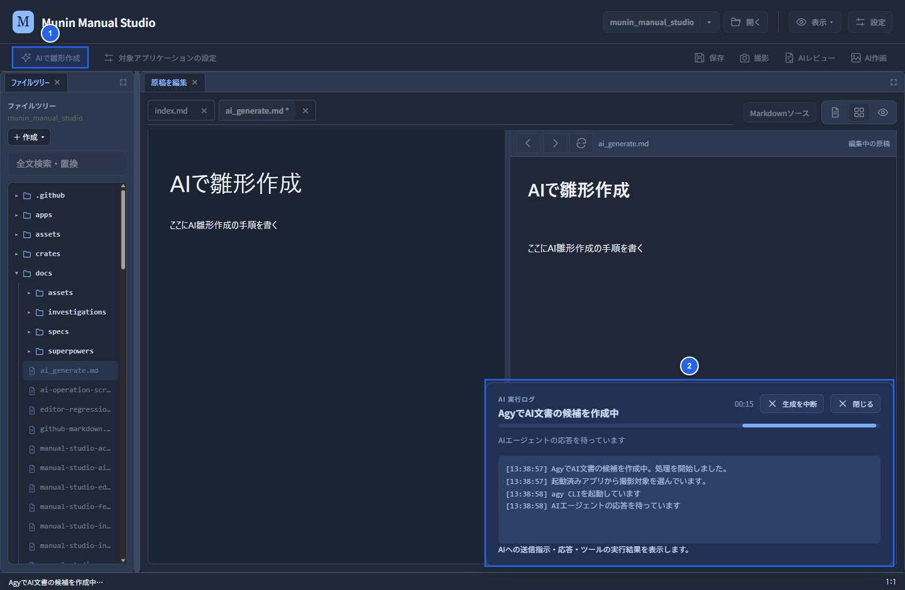

# AIで雛形作成

「AIで雛形作成」は、AIエージェント（Agy）による構成案の作成やMarkItsでの画面撮影を行い、現在開いているMarkdownファイルにマニュアルの雛形（候補）を自動で作成する機能です。

## 機能の概要

この機能を実行すると、選択したMarkdownファイルに対して以下の処理が行われます。

* **AIエージェント（Agy）による構成案の作成**: マニュアルの構成案や文書候補を生成します。
* **MarkItsでの画面撮影**: 手順に合わせて画面を撮影します。
* **進行状況の確認**: 専用ウィンドウ上で作成処理の進行ログを確認できます。

## 作成手順

1. **対象ファイルの選択と表示**
   画面左側のファイルツリーから、雛形を作成または編集したいMarkdownファイル（例：`ai_generate.md`）を選択し、エディタで開きます。

2. **「AIで雛形作成」の実行**
   画面上部の作業バーにある **「AIで雛形作成」** ボタン（①）をクリックすると、開いているMarkdownファイルに対して雛形の作成処理が開始されます。

3. **進行状況とログの確認**
   処理が始まると、画面上に **「AgyでAI文書の候補を作成中」** ウィンドウ（②）が表示されます。このウィンドウでは、AIエージェント（Agy）による構成案の作成状況やMarkItsでの画面撮影の進捗、詳細な進行ログをリアルタイムで確認できます。

