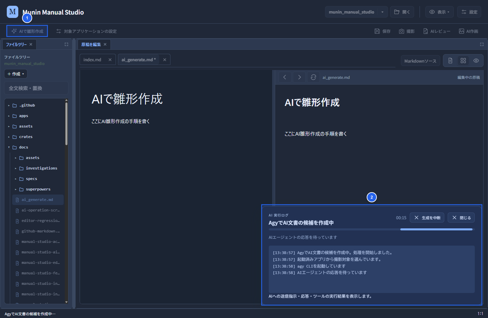

# AIで雛形作成

「AIで雛形作成」は、AIエージェント（Agy）による構成案の作成やMarkItsでの画面撮影を通じて、開いているMarkdownファイルにマニュアルの雛形（候補）を作成する機能です。

## 作成手順

1. 編集または作成先のMarkdownファイル（例：`ai_generate.md`）をファイルツリーから選択して開きます。
2. 画面上部の作業バーにある **「AIで雛形作成」** ボタン（①）をクリックして実行を開始します。
3. **「AgyでAI文書の候補を作成中」** ウィンドウ（②）が表示され、AIエージェントによる構成案の作成やMarkItsでの画面撮影・進行ログが確認できます。

