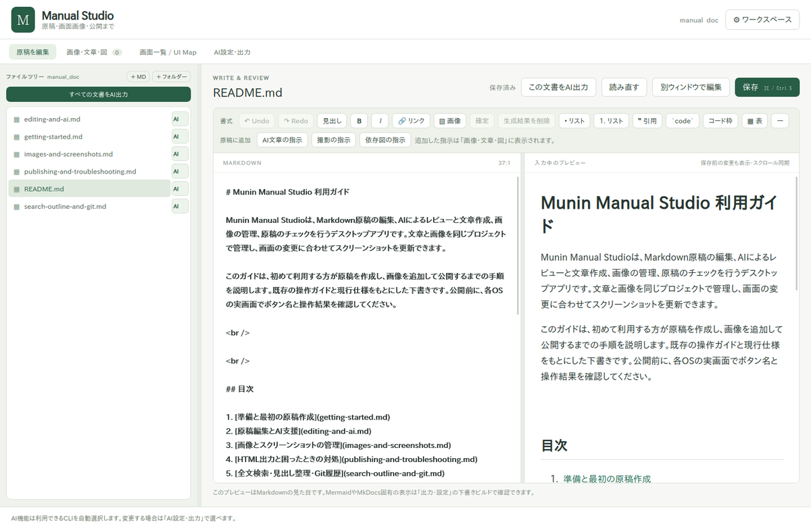

# Munin Manual Studio 利用ガイド

Munin Manual Studioは、Markdown原稿の編集、AIによるレビューと文章作成、画像の管理、原稿のチェックを行うデスクトップアプリです。文章と画像を同じプロジェクトで管理し、画面の変更に合わせてスクリーンショットを更新できます。

このガイドは、初めて利用する方が原稿を作成し、画像を追加して公開するまでの手順を説明します。既存の操作ガイドと現行仕様をもとにした下書きです。公開前に、各OSの実画面でボタン名と操作結果を確認してください。

 

<!-- screenshot:ref id=shot-bb638e11-2121-4e8e-a516-93dc03fcc66a -->

<!-- /screenshot:ref -->

 

## 目次

1. [準備と最初の原稿作成](getting-started.md)
2. [原稿編集とAI支援](editing-and-ai.md)
3. [画像とスクリーンショットの管理](images-and-screenshots.md)
4. [HTML出力と困ったときの対処](publishing-and-troubleshooting.md)
5. [全文検索・置換・Git履歴](search-outline-and-git.md)

## 基本の流れ

1. アプリを起動し、原稿を保存するプロジェクトフォルダーを開きます。
2. Markdown原稿を作成し、見出しと本文を編集します。
3. 必要に応じてAIレビューを実行し、修正候補を確認して反映します。
4. リソース一覧で画像を用意し、原稿に挿入します。
5. プレビューと原稿チェックで内容を確認します。HTML出力は外部連携またはCLIで行います。

Markdown編集、手動撮影、保存済み手順での再撮影、MarkItsによる画像編集はAI設定なしで利用できます。AI支援を利用する場合はAI接続、HTML出力にはPythonとMkDocsの準備が必要です。

## この下書きの参照元

* [プロジェクト概要](../README.md)
* [起動方法と配布版の説明](../apps/manual-studio/README.md)
* [既存の編集ワークフロー](../docs/manual-studio-editor-workflows.md)
* [現行仕様一覧](../docs/specs/README.md)

この下書きのHTML出力は未確認です。公開対象や画像保存先は、利用するプロジェクトの設定で確認してください。
