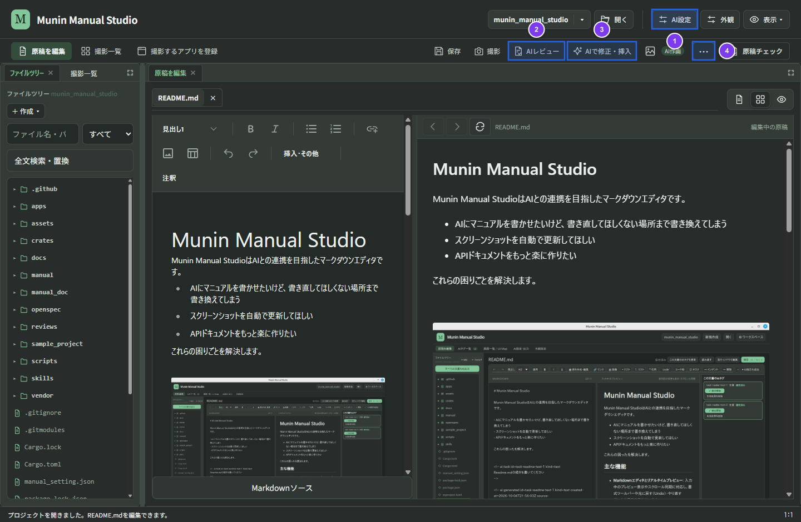

# 原稿編集・AI支援・AIターミナル

## 編集・ソース・プレビューを使う

ファイルツリーからMarkdown原稿を開くと、原稿タブが追加されます。

* **通常編集とMarkdownソース編集**: 通常編集（リッチテキスト表示）で文章や書式を整え、Markdown記法を直接変更するときは編集領域下部の「**Markdownソース**」でソース編集へ切り替えます。
* **書式ツールバー**: 元に戻す（Undo）／やり直す（Redo）、見出し（H1〜H6）、太字、斜体、取り消し線、表の作成・編集、リンク、画像、箇条書き、番号付きリストを常時表示します。引用、インラインコード、Mermaid図、コード枠、タスクリスト、インデント、区切り線は「**挿入・その他**」から挿入できます。
* **タブ管理**: 複数の原稿を開いてタブを切り替えられます。タブごとに編集中の文章、カーソル位置、Undo履歴を保持し、次回起動時にも復元されます。未保存のタブを閉じる際やプロジェクト変更時には保存確認が表示されます。

## 1. AI接続を準備する

1. 画面上部の「**AI設定**」（①）を開きます。
2. 文章・図の生成に使う接続方式（CLIツール／ローカルLLM／クラウドAPI）を選び、必要な接続情報やモデルを指定します。
3. 選択範囲の相談機能やAIターミナルでCLI（Codex / Claude / Agy）を使う場合は、「相談先AIごとの設定」で各CLIのモデルを個別に指定できます。
4. 「AI作画」を使う場合は、画像生成用の接続を個別に設定するか「文章・図の生成AIと同じ接続」を選びます。

**操作後の結果**: 設定は `manual_setting.json` 等に保存され、AIレビュー・AI文書作成・AI作画で利用できるようになります。

## 2. 読者目線でAIレビューする

1. 対象の原稿を開きます（一部分だけを確認する場合はその文章を選択します）。
2. 上部の「**AIレビュー**」（②）を開きます。
3. 想定読者と文書の目的を入力し、文書全体または選択範囲を指定してレビューを実行します。
4. 右側のパネルに表示される指摘（「**読者目線**」「**校正**」「**画像と説明**」）を確認します。

**操作後の結果**: レビューの実行だけでは本文は変更されません。「該当箇所へ」で対象箇所へ移動し、反映したい指摘は「**修正案を作成**」、採用しない指摘は「**見送り**」を選べます。

> [!NOTE]
> APIまたはローカルLLM接続では、対象範囲のローカル画像（PNG・JPEG・WebP、最大6枚・各8 MBまで）も送信して画像と説明の整合を確認します。CLI接続や外部URL画像は「未確認」と表示されるため、目視でも確認してください。

## 3. AIで文章を作成・修正する

1. 修正する文章を選択します（新しい文章を挿入する場合は挿入位置にカーソルを置きます）。
2. 上部の「**AIで修正・挿入**」（③、選択中は「選択範囲をAIで編集」、`Ctrl/Cmd+Shift+G`）を開きます。
3. 指示を入力するか、簡潔化・初心者向け説明・手順化・校正などの目的を選んで「**候補を作成**」を押します。
4. 生成されたDiff（変更前後の比較）を確認し、変更ごとに採用チェックを選んで「**選んだ変更を反映**」で確定します。

**操作後の結果**: 選択した変更だけが原稿に反映され、保護したい他の文章は書き換わりません。反映後も通常のUndo（`Ctrl/Cmd+Z`）で元に戻せます。

### 選択範囲ツールバーでの相談と書き直し

リッチエディタ上で文章を選択すると表示されるツールバーの「**AI操作**」では、標準の「書き直し候補の作成」に加え、「**書き直し方針を相談**」を選べます。相談先コンボボックスで **Codex・Claude・Agy** または既定のAPI接続を選び、AIの回答を確認してから追加指示を付けて同じ選択範囲の書き直しへ進めます（相談時に選んだAIがそのまま引き継がれます）。

## 4. その他の文書操作と執筆方針

上部の「**⋯**」（④、その他の文書操作）からは次の機能を利用できます。

* **執筆方針**: プロジェクト共通の想定読者・目的・操作方針を設定します。
* **AIで全体の下書きを作る**: 設定したAIで複数ページの下書き候補を作成し、採用するものを確認して反映します。
* **画像の表示設定**: 原稿内の画像の表示幅（1〜100%）・配置・キャプションを設定します。
* **ショートカット**: キーボードショートカット一覧を表示します。
* **読み直す**: 外部ツールやAIターミナルで変更された原稿ファイルを再読み込みします。
* **別ウィンドウで編集**: 現在の原稿を別ウィンドウで開いて並べて編集します。

## 5. AIターミナルでマニュアルと注釈画像を生成する

上部ナビゲーションの「**AIターミナル**」を開くと、アプリ内のターミナルから対話型AI CLI（**Codex / Claude / Agy**）を起動してマニュアル執筆を依頼できます。

1. 「**AIターミナル**」タブを開き、使用するAI（Codex / Claude / Agy）を選びます。
2. 対象アプリのソースコードが別フォルダにある場合は、「**作業フォルダ設定**」でCLIの作業フォルダを指定します（初期値はプロジェクトルートです。作業フォルダを変更しても、生成される原稿と画像は現在のマニュアルプロジェクトに保存されます）。
3. 「**接続**」を押してAI CLIを起動します。接続時に `.munin/ai-terminal/` へ専用ガイド（`guide.md`、`tools.json`、`markits-manual.md`）が自動生成され、AIに初期指示として渡されます。
4. ターミナル上で「対象アプリを起動し、設定画面を撮影して操作箇所に番号を付け、マニュアルを書いて」のように依頼します。AIは同梱の `--studio-tools`（`windows` / `capture` / `inspect` / `annotate`）を使って実画面の撮影・UIMap解析・MarkIts注釈付け・Markdown執筆を行います。
5. AIの作業が完了したら、ターミナル上部の「**変更を読み直す**」を押します。

**操作後の結果**: AIが生成・更新したMarkdown原稿と `docs/assets/` 内の完成画像がファイルツリーと編集画面に反映されます。
