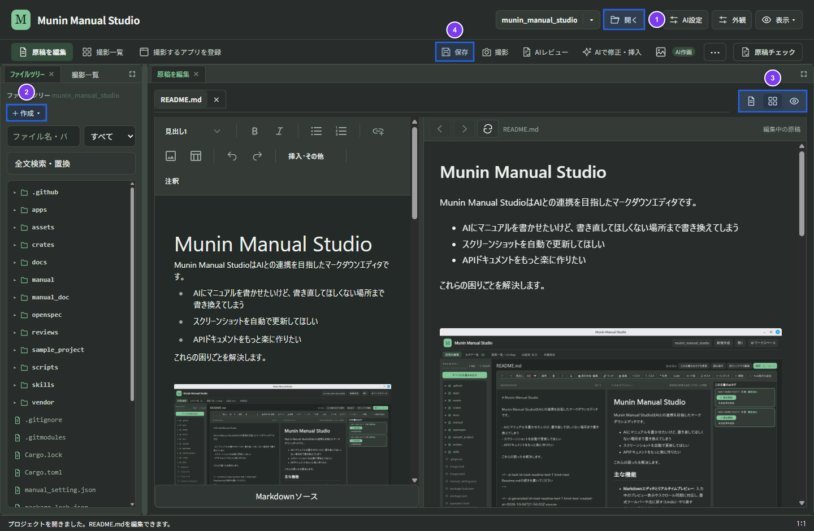

# 準備と最初の原稿作成

## 前提条件と利用環境の確認

配布版を利用する場合は、GitHub ReleasesのZIPを展開してOSに対応するアプリを起動します。補助実行ファイルも含め、展開後のフォルダー配置を保持してください。

| OS | 起動するアプリ | 必要な環境・権限 |
| --- | --- | --- |
| Windows | `manual-studio.exe` | Microsoft Edge WebView2 Runtime |
| macOS | `Munin Manual Studio.app` | 撮影には画面収録、操作記録・ウィンドウ操作にはアクセシビリティ権限 |
| Linux | `manual-studio` | WebKitGTK 4.1、GTK 3。操作記録にはX11セッション |

Markdown編集と手動撮影には、Node.jsやRustのインストールは不要です。macOSで配布版の起動をOSに拒否された場合は、システム設定の「プライバシーとセキュリティ」で起動を許可してください。

### ソースから起動する場合

リポジトリルートで次のコマンドを実行します。Python 3が必要で、初回起動時やソース変更時にはフロントエンドとRustバイナリの自動ビルドが行われます（ビルド環境の詳細は[アプリのREADME](../apps/manual-studio/README.md)を参照してください）。

```sh
python3 start_manual_studio.py
```

Windowsでは `python start_manual_studio.py`、LinuxとmacOSでは `./start-manual-studio.sh` も利用できます。

## プロジェクトを開いて原稿を作成する



### 操作手順

1. アプリを起動し、上部の「**開く**」（①）を押して原稿のあるフォルダーを指定します（フォルダ名ボタンの「▾」から最近開いたフォルダーを選ぶこともできます）。
2. 左ペインのファイルツリーから既存のMarkdown原稿を選ぶか、「**＋ 作成 ▾**」（②）を押して「**原稿を作成**」または「**フォルダーを作成**」を選びます（ツリー上のフォルダーを右クリックして作成することもできます）。
3. 右上の表示切替ボタン（③）で「**編集のみ**」「**編集＋プレビュー**」「**プレビューのみ**」を切り替えながら原稿を執筆します。
4. 上部の「**保存**」（④）または `Ctrl+S`（macOSは `Cmd+S`）で原稿を保存します。

### 操作後の結果

* 選択・作成した原稿がタブとして開き、プレビュー画面に見出し・本文・画像・Mermaid図が描画されます。
* 未保存の変更がある場合は原稿タブ名に `*` が表示され、保存が完了すると `*` が消えます。
* 設定のないフォルダー直下にMarkdown原稿がある場合、そのフォルダー自身を原稿フォルダーとして扱い、画像は `assets` に保存されます。既存の保存先設定や `docs` 構成がある場合はその構成を維持します（上部のフォルダー名メニュー「原稿・画像の保存先」から確認・変更できます）。

## 最初の原稿を書く

最初は、読者が一つの作業を完了できる短い原稿を作成します。次のテンプレートを参考に、対象の操作に合わせて書き換えてください。

```markdown
# はじめての操作

このページでは、設定を変更して保存する手順を説明します。

## 作業前の確認

- 対象アプリを起動していること。
- 変更する設定値が決まっていること。

## 操作手順

1. 設定画面を開きます。
2. 設定値を入力します。
3. 保存を実行します。

## 結果の確認

設定画面を開き直し、入力した値が保持されていることを確認します。
```

保存失敗や外部エディターとの競合が発生した場合は、編集中の内容が保護され、画面上で「再試行」や「変更を確認」を行えます。続いて、[原稿編集・AI支援・AIターミナル](editing-and-ai.md)で編集と見直しの方法を確認します。
