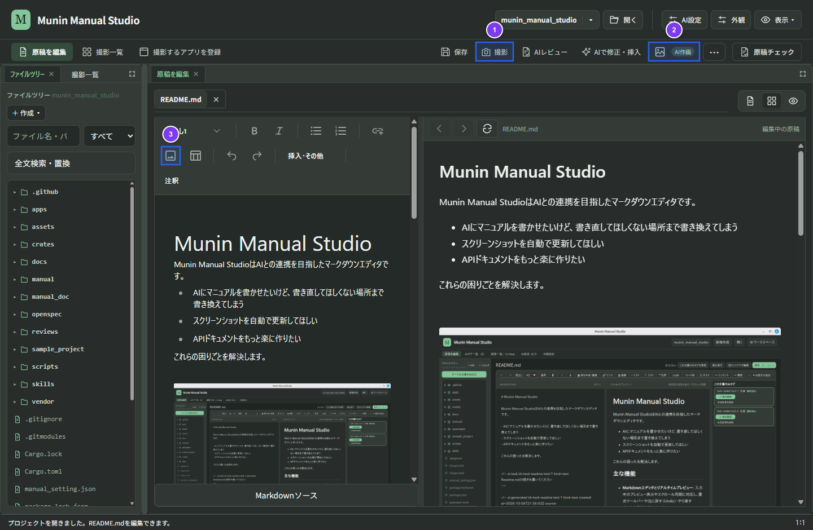

# 画像とスクリーンショットの管理

## 1. MarkItsで画面を撮影・注釈して挿入する

撮影、撮影対象アプリ、操作記録、UI探索（UIMap）、再撮影、注釈、クロップ、および編集履歴は **MarkIts** が管理し、Munin Manual Studioは完成画像のプロジェクトへの取り込みと原稿への挿入・表示設定を担当します。手動での撮影や編集にAI設定は不要です。

### 操作手順

1. 原稿の挿入したい位置にカーソルを置き、画面上部の「**撮影**」（①）を押します。
2. MarkItsが起動し、撮影対象を選ぶ画面が開きます。対象のアプリケーションウィンドウまたは全画面を選択します。
3. MarkItsで画面を撮影し（必要に応じて操作記録も実行できます）、番号バッジ・枠線・矢印・吹き出し・モザイク・クロップを編集します。
4. MarkItsで保存して編集を終了します。

### 操作後の結果

* 完成したPNG画像がプロジェクトの画像保存先（`docs/assets/` または `assets/`）へ自動的に取り込まれ、元のカーソル位置に挿入されてプレビューが更新されます（途中で原稿やプロジェクトが切り替わった場合は、誤挿入を防ぐため画像の保存のみを行います）。
* 取り込まれたPNGファイル内には、MarkItsの再編集用メタデータ（クロップ前の原本、UIMap、注釈、操作記録）が保持されます。

## 2. 既存画像の再編集・再撮影

1. 原稿内に挿入されている画像の「**編集**」を押します。
2. その画像の編集メタデータ（原本、UIMap、注釈、クロップ、操作記録）を引き継いだ状態でMarkItsの編集画面が直接開きます。
3. 注釈の位置調整やクロップ範囲の変更、またはMarkItsの履歴から操作記録を使った再撮影を行い、保存して終了します。

**操作後の結果**: 編集後の完成画像がMunin Manual Studioへ取り込まれ、原稿内の画像参照とプレビューが更新されます。HTML出力時には、公開用コピーから編集メタデータが自動的に除去されます。

## 3. AI作画で説明用の画像を作る

1. 原稿の挿入位置にカーソルを置き、上部の「**AI作画**」（②）を開きます。
2. 画像の目的・内容・見た目を入力して生成を実行します（画像生成に対応するAI接続が必要です）。
3. 生成された画像のプレビューを確認し、必要に応じて追加指示で修正したり、MarkItsで注釈・クロップを加えたりしてから原稿へ挿入します。

**操作後の結果**: 生成された画像がプロジェクトの資産フォルダーに保存され、原稿へ挿入されます。

## 4. 既存画像の挿入・差し替え・表示設定

* **書式ツールバーからの挿入**: 書式ツールバーの「**画像**」（③）を押してローカルの画像ファイルを選択し、原稿へ挿入できます。
* **ファイルツリーからの操作**: 左ペインのファイルツリーから画像ファイルをクリックして閲覧タブで実寸確認したり、原稿へドラッグ＆ドロップして挿入したりできます。原稿内の既存画像の上へドロップすると、キャプションや表示設定を保持したまま参照先だけを差し替えます。
* **画像の表示設定**: 原稿操作の「**⋯ → 画像の表示設定**」から、本文幅に対する表示幅（1〜100％または指定なし）、配置（左・中央・右寄せ）、およびキャプションを設定できます。

保存先の詳細は [フォルダーと保存先](../docs/specs/workspace-storage.md) および [StudioとMarkItsの役割](../docs/markits-ownership.md) を参照してください。
