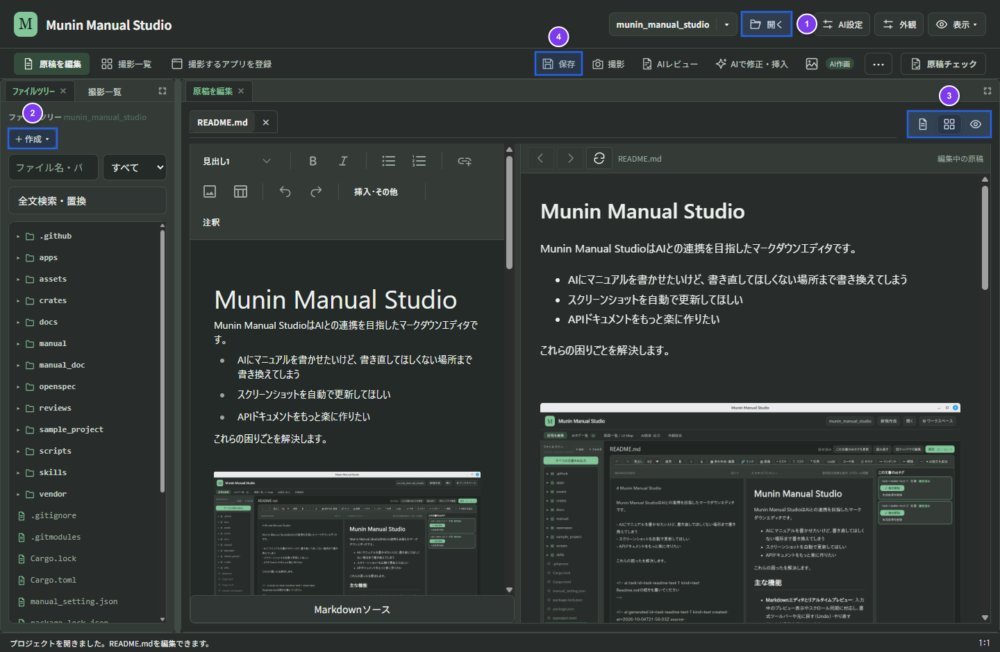

# Munin Manual Studio 利用ガイド

Munin Manual Studioは、Markdown原稿の編集、AIによるレビューと文章作成、MarkItsと連携したスクリーンショット撮影・注釈、および原稿チェックを行うデスクトップアプリです。文章と画像を同じプロジェクトで管理し、画面の変更に合わせてスクリーンショットを更新できます。

このガイドでは、初めて利用する方がプロジェクトを開き、原稿と画像を作成・管理して公開するまでの手順を説明します。

## 目次

1. [準備と最初の原稿作成](getting-started.md)
2. [原稿編集・AI支援・AIターミナル](editing-and-ai.md)
3. [画像とスクリーンショットの管理](images-and-screenshots.md)
4. [原稿チェック・HTML出力と困ったときの対処](publishing-and-troubleshooting.md)
5. [全文検索・置換・Git履歴](search-outline-and-git.md)

## 基本の流れ

1. アプリを起動し、上部の「**開く**」（①）から原稿を保存するプロジェクトフォルダーを開きます。
2. 左ペインのファイルツリーで原稿を選ぶか、「**＋ 作成 ▾**」（②）で新しいMarkdown原稿を作成します。
3. 「**編集画面の表示**」（③）で「編集＋プレビュー」などを切り替えながら見出しと本文を編集し、「**保存**」（④、Ctrl/Cmd+S）で保存します。
4. 必要に応じて「**撮影**」からMarkItsで画面を撮影・注釈して原稿へ挿入し、「**AIレビュー**」や「**AIで修正・挿入**」で文章を見直します。
5. 「**原稿チェック**」でリンク切れや画像参照を確認し、外部連携またはCLI（MkDocs）で静的HTMLを出力します。

Markdown編集、MarkItsによる手動撮影・操作記録・再撮影・画像編集はAI設定なしで利用できます。AIによる文章作成・レビュー・AIターミナルを利用する場合はAI接続、HTML出力にはPythonとMkDocsの準備が必要です。

## 関連情報

* [プロジェクト概要](../README.md)
* [起動方法と配布版の説明](../apps/manual-studio/README.md)
* [StudioとMarkItsの役割](../docs/markits-ownership.md)
* [現行仕様一覧](../docs/specs/README.md)
