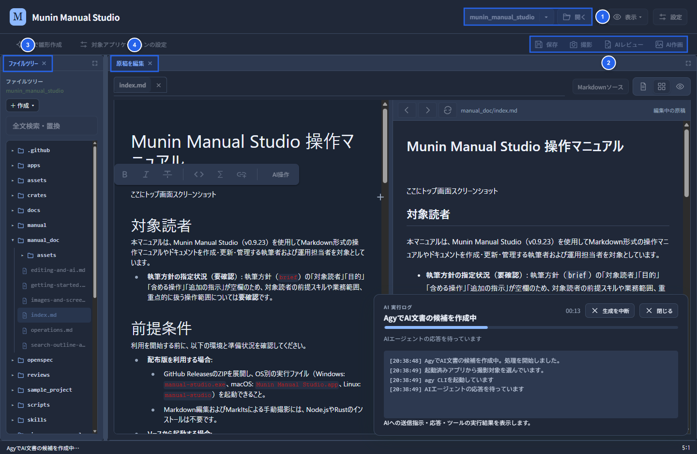
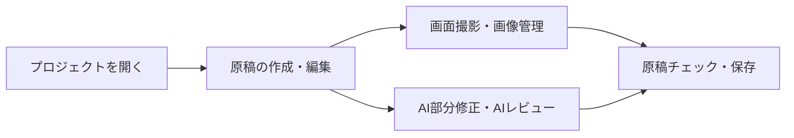

# Munin Manual Studio 操作マニュアル

## 画面説明



1. **プロジェクト操作**（「**開く**」 / フォルダ名メニュー）：対象プロジェクトの選択や切り替えを行います。
2. **原稿の操作**（「**保存**」 / 「**撮影**」 / 「**AIレビュー**」 / 「**AI作画**」）：原稿の保存、画面の撮影、AIによるレビューや画像生成を実行します。
3. **ファイルツリー**：プロジェクト内のMarkdown原稿やフォルダーの選択・新規作成（「**＋ 作成 ▾**」）、および「**全文検索・置換**」を行います。
4. **原稿を編集**：左側のエディタ（**Markdown原稿**）と右側のプレビュー（**Markdownプレビュー**）で、表示を切り替えながら原稿を作成・編集します。

## 対象読者

本マニュアルは、Munin Manual Studio（v0.9.23）を使用してMarkdown形式の操作マニュアルやドキュメントを作成・更新・管理する執筆者および運用担当者を対象としています。

* **執筆方針の指定状況（要確認）**: 執筆方針（`brief`）の「対象読者」「目的」「含める操作」「追加の指示」が空欄のため、対象読者の前提スキルや業務範囲、重点的に扱う操作範囲については**要確認**です。

## 前提条件

利用を開始する前に、以下の環境と準備状況を確認してください。

* **配布版を利用する場合**:
  * GitHub ReleasesのZIPを展開し、OS別の実行ファイル（Windows: `manual-studio.exe`、macOS: `Munin Manual Studio.app`、Linux: `manual-studio`）を起動できること。
  * Markdown編集およびMarkItsによる手動撮影には、Node.jsやRustのインストールは不要です。
* **ソースから起動する場合**:
  * Python 3、Node.js（npm）、Rust（Cargo）が用意されていること。
  * 初回取得時は `git clone --recurse-submodules`、または既存環境で `git submodule update --init --recursive` により `crates/markits` サブモジュールを取得していること。
* **外部連携・追加機能を利用する場合（任意）**:
  * **AI部分修正・AIレビュー・AI作画**: 「**AI設定**」で使用する接続先（CLIツール：Agy / Claude / Codex、ローカルLLM、またはクラウドAPI）の準備と認証が完了していること。
  * **HTML出力**: PythonおよびMkDocs（`mkdocs-material`）環境が用意されていること（具体的な出力コマンドや手順の詳細は**要確認**）。
  * **実際に運用する接続方式・対象アプリ（要確認）**: プロジェクトで使用するAI接続方式、および撮影対象アプリの起動パス・起動引数・作業フォルダは**要確認**です。

## 導入

<br />

<br />

### アプリケーションの概要

Munin Manual Studioは、必要な箇所だけを安全にAI編集し、MarkItsと連携したスクリーンショットの撮影・注釈・再撮影までを完結できるマークダウンエディタです。

* **Markdown編集**: リッチテキスト編集・Markdownソース編集の切替、分割プレビュー（編集＋プレビュー）、Mermaid図、書式ツールバー、全文検索・置換・Git履歴に対応します。
* **AI部分修正・レビュー**: 「**AIで修正・挿入**」で選択範囲やカーソル位置の文章・図を生成し、Diffを確認して反映します。「**AIレビュー**」で本文を変更せずに読者目線・校正・画像整合をチェックします。
* **スクリーンショット管理（MarkIts連携）**: AI設定なしで実画面の撮影・操作記録・注釈・クロップ・再撮影・候補比較が可能です。
* **リソース管理**: プロジェクト内の撮影画像・通常画像・AI作画を一覧管理し、使用原稿の確認・挿入・差し替えに対応します。
* **AIターミナル連携**: Codex・Claude・Agyをアプリ内ターミナルから起動し、同梱MarkItsツール（`--studio-tools`）で実画面の撮影・UIMap解析・注釈付きマニュアル生成を実行できます。
* **原稿チェック・HTML出力**: リンク切れや画像参照を「**原稿チェック**」で確認し、外部連携やCLI（MkDocs）で静的HTMLを出力します。

### 起動方法

ソース環境から起動する場合は、プロジェクトルート（`start_manual_studio.py` のあるフォルダー）で以下を実行します。

```sh
python3 start_manual_studio.py
```

### 基本ワークフロー



## 基本操作

画面各部の主な操作入口は以下のとおりです。

| 操作区分     | 主なUI表示・メニュー                                             | 概要                                                              |
| -------- | ------------------------------------------------------- | --------------------------------------------------------------- |
| プロジェクト操作 | 「**開く**」 / フォルダ名メニュー                                    | 対象プロジェクトのフォルダーを開く、最近開いたフォルダーの選択、「**原稿・画像の保存先**」の確認を行います。        |
| ファイル管理   | 左ペイン / 「**＋ 作成 ▾**」                                     | 既存のMarkdown原稿の選択、新規原稿・フォルダーの作成を行います。                            |
| 表示切替・保存  | 「**編集＋プレビュー**」等 / 「**保存**」                              | リッチテキスト編集・Markdownソース編集・分割プレビューの切替、および原稿の保存（`Ctrl/Cmd+S`）を行います。 |
| AI支援     | 「**AI設定**」 / 「**AIレビュー**」 / 「**AIで修正・挿入**」 / 「**AI作画**」 | AI接続の設定、本文を変更しない指摘確認、Diff確認を伴う部分修正・挿入、説明用画像の生成を行います。            |
| 撮影・画像管理  | 「**撮影するアプリを登録**」 / 「**スクリーンショット**」 / 「**リソース一覧**」       | 対象アプリの登録、MarkItsでの撮影・注釈・クロップ、画像の挿入・再撮影・候補比較を行います。               |
| 検索・履歴・検証 | 「**全文検索・置換**」 / 「**原稿チェック**」 / 「**⋯**（その他の文書操作）」        | 本文の検索と選択置換、リンク切れ・画像参照の検査、執筆方針の設定、変更の読み直し、Git履歴管理を行います。          |

詳細な手順は、[操作手順と確認・トラブル対処](operations.md)を参照してください。
