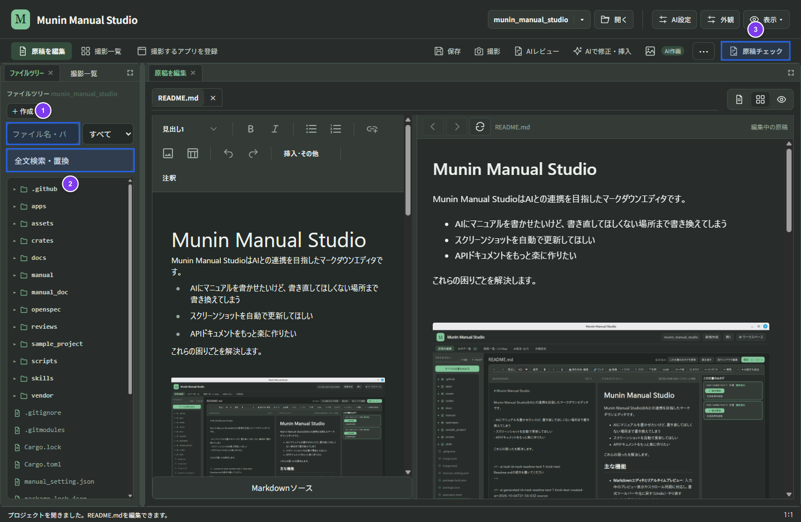

# 原稿チェック・HTML出力と困ったときの対処



## 1. 公開前に原稿をチェックする

1. 原稿の保存完了（タブ名に `*` がないこと）を確認します。
2. プレビューで文章、画像、Mermaid図の表示を確認します。
3. 画面上部の「**原稿チェック**」（③）を開き、チェックを実行します。
4. 検出された問題の「**該当箇所を開く**」で対象の原稿へ移動し、リンク切れや画像参照の不備を修正して保存します。
5. 再度「**原稿チェック**」を実行し、問題が解消されたことを確認します。

**操作後の結果**: ローカルファイルへのリンク切れ、Markdownの見出しアンカー参照切れ、画像の欠落や不正が公開前に一覧表示されます（外部WebサイトURLの疎通は検査しないため、外部リンクは別途ブラウザーで確認してください）。

## 2. HTML出力の準備と実行

静的HTMLの出力には Python と `mkdocs-material` が必要です。プロジェクトに専用の仮想環境を作成する場合は、プロジェクトフォルダーで次を実行します。

Linux・macOS:

```sh
python3 -m venv .venv
.venv/bin/python -m pip install mkdocs-material
```

Windows (PowerShell):

```powershell
python -m venv .venv
.venv\Scripts\python -m pip install mkdocs-material
```

Munin Manual Studioのビルド処理は、プロジェクトの `.venv` 内にあるMkDocs実行ファイルを優先して探索します。

### CLIで下書き・完成版HTMLを出力する

HTML出力は外部連携またはCLI（`manualctl`）から実行します。`/path/to/project` は対象プロジェクトのフォルダーパスに置き換えてください。

```sh
# 完成版ビルド（公開前チェックを通過した場合のみ出力）
manualctl build-mkdocs --root /path/to/project

# 下書きビルド（作成途中の表示確認用）
manualctl build-mkdocs --root /path/to/project --draft
```

| 出力方法 | 利用する場面 | 原稿チェックに問題がある場合 |
| --- | --- | --- |
| 下書き（`--draft`） | 作成途中のレイアウト・Mermaid・リンク確認 | 問題を残したままHTMLを出力できる |
| 完成版 | 配布・公開するHTMLの出力 | ビルドを停止し、既存の出力を保護する |

**操作後の結果**: 設定された出力先（既定は `manual/`）に静的HTMLサイトが生成されます。公開出力される画像からは、MarkItsの編集用メタデータ（クロップ前の原本や操作記録など）が自動的に除去されます。

## 3. 困ったときの対処（トラブルシューティング）

| 症状 | 確認と対処 |
| --- | --- |
| 原稿が保存されない | ヘッダーや下部の保存失敗・競合表示を確認します。保存先フォルダーの権限や外部変更を確認し、`Ctrl/Cmd+S` または「再試行」を実行します。 |
| 別のエディターやAIターミナルの変更と競合した | 編集中の内容は保持されます。「変更を確認」で保存先との差分を確認するか、外部の変更を取り込む場合は「⋯ → 読み直す」（AIターミナルでは「変更を読み直す」）を実行します。 |
| 画面を撮影できない | 対象ウィンドウが開いているか、最小化されていないか確認します。macOSでは「画面収録」と「アクセシビリティ」権限、Linuxの操作記録ではX11セッションを確認してください。 |
| AIレビュー・文章作成が失敗する | 上部の「AI設定」で接続方式・エンドポイント・APIキー・CLI認証の状態を確認し、保持された指示から再試行します。 |
| AIレビューで画像が「未確認」になる | CLI接続や外部URL画像は画像送信の対象外です。APIまたはローカルLLM（ビジョン対応モデル）でローカル画像（PNG/JPEG/WebP、6枚・各8 MB以下）を使用してください。 |
| HTML生成がスキップされる | MkDocsがインストールされているか確認し、プロジェクトの `.venv` に `mkdocs-material` を導入してください。 |
| 完成版HTMLビルドが停止する | 「原稿チェック」で報告されたリンク切れや画像欠落を修正してから再実行してください。途中の確認には `--draft` を使用できます。 |
