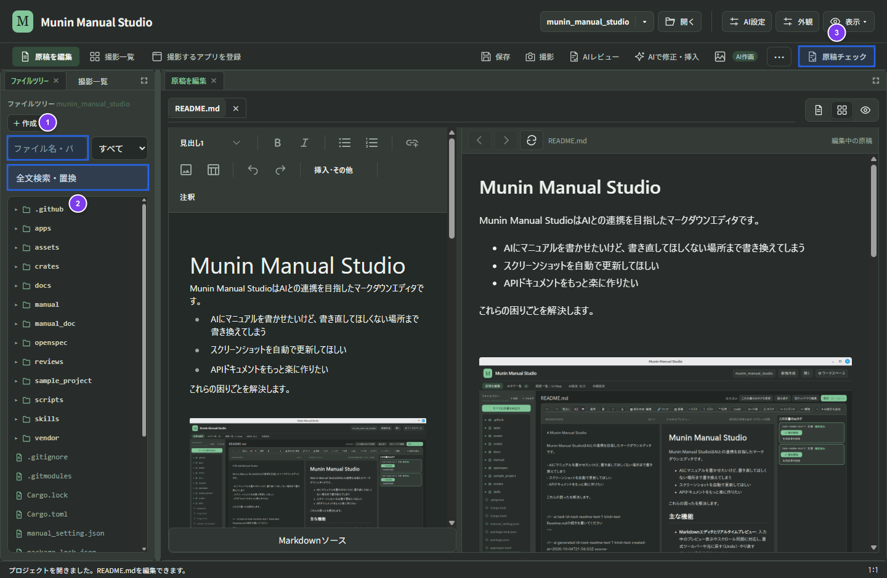
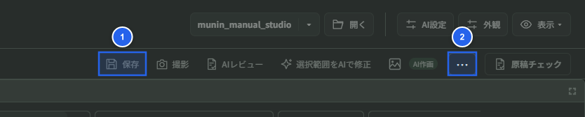

# 全文検索・置換・Git履歴

## 1. ファイルツリーの検索とファイル移動

### ファイル名・パスの絞り込み

1. 左ペインのファイルツリー上で `Ctrl+F`（macOSは `Cmd+F`）を押すと、検索欄（①）が開きます。
2. ファイル名やパスの一部を入力し、必要に応じて右隣の表示範囲（「**すべて**」／「**原稿のみ**」）を切り替えます。
3. 検索を終了するときは `Esc` キーを押すと、絞り込み条件が解除されて検索欄が閉じます。

### ファイル移動と相対リンクの自動更新

 

1. ファイルツリー上の原稿や画像を右クリックして「**移動してリンクを更新**」を選ぶか、移動先フォルダーへドラッグ＆ドロップします。
2. 移動先パスと更新されるMarkdown内の相対リンク一覧を確認し、適用します。

   **操作後の結果**: ファイルが移動されると同時に、プロジェクト内の関連するMarkdown参照パスも自動更新されます（移動前のバックアップ情報は `.munin/file-moves/` に保存されます）。

## 2. Markdown本文の全文検索と選択置換

1. 左ペインの「**全文検索・置換**」（②）を押します。
2. 検索する文字列を入力して「**検索**」を押します（プロジェクト内のMarkdown本文を文字どおり検索します）。
3. 検索結果のファイル名・行・列をクリックすると、該当箇所をMarkdownソース上で選択して確認できます。
4. 置換する場合は、対象の結果にチェックを付け（「全選択」「選択解除」も利用可能）、置換後の文字列を入力して「**選んだ置換を確認**」を押します。
5. 変更前後を比較し、「**選んだ箇所を置換**」で反映します。

**操作後の結果**: 選択した箇所だけが置換されて保存されます。直後の状態であれば「**置換を元に戻す**」で一括取り消しが可能です（置換後に原稿を別途編集した場合は、後からの編集を保護するため一括取り消しは行われません）。

## 3. Gitで原稿の履歴を残す・復元する

原稿単位で変更履歴を記録し、過去の版と比較・復元できます。

### 原稿をコミットする

1. 対象の原稿を開き、「**保存**」（①）を押して保存します。
2. 上部の「**⋯**（その他の文書操作）」（②）または原稿操作から「**Git履歴・復元**」を開きます（Git未管理のフォルダーでは「**Gitで履歴管理を始める**」から初期化できます）。
3. コミットの説明を入力し、「**この原稿をコミット**」を押します。

**操作後の結果**: 開いている原稿ファイルの変更だけがGit履歴に記録され、他ファイルの未コミット変更やステージ内容は巻き込みません（Gitの `user.name` と `user.email` が未設定の場合は、あらかじめプロジェクトで設定してください）。
